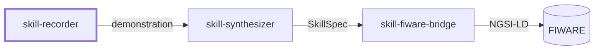
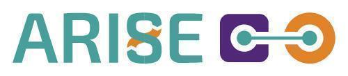

# Skill Recorder

A ROS 2 module that records an operator's task demonstration (RGB-D video and audio narration) as one synchronised demonstration package.

> **Status:** this repository is being prepared. The first public release, with source code, installation guide and a runnable example, is planned for **June 2027**.

## Related modules

`skill-recorder` is designed to be used on its own or together with two companion modules:

*skill-fiware-bridge can also publish task-step and component events from your own robot application.*

- [skill-synthesizer](https://github.com/eurodao/skill-synthesizer)
- [skill-fiware-bridge](https://github.com/eurodao/skill-fiware-bridge)

## Features

- Records a demonstration through a single ROS 2 action, with progress feedback.
- Stores video, depth and audio as one synchronised, self-describing package.
- Designed to feed skill-synthesizer, which turns the demonstration into a draft skill.

## Requirements

- **OS:** Ubuntu 24.04.
- **ROS 2:** Jazzy (eProsima Vulcanexus).
- **Python:** 3.12.

## Usage

The recorder is used through a ROS 2 action. Interfaces, installation and a runnable example will be documented with the first release.

## License

Copyright © 2026 euroDAO SAS.

Code: [GNU General Public License v3.0 only](LICENSE) (`SPDX-License-Identifier: GPL-3.0-only`).

## Maintainer

**euroDAO SAS**, Montpellier, France · [eurodao.com](https://eurodao.com) · info@eurodao.com

## Acknowledgements

Developed by euroDAO SAS within the MENTOR experiment of the ARISE project, for the ARISE Catalog.

&nbsp;&nbsp;

Funded by the European Union. Views and opinions expressed are however those of the author(s) only and do not necessarily reflect those of the European Union or European Commission. Neither the European Union nor the granting authority can be held responsible for them. Co-funded under Horizon Europe Programme of the European Union under Grant Agreement no. 101135784.
